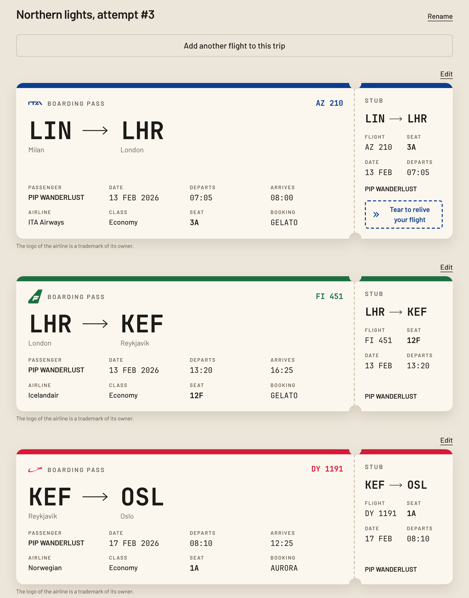
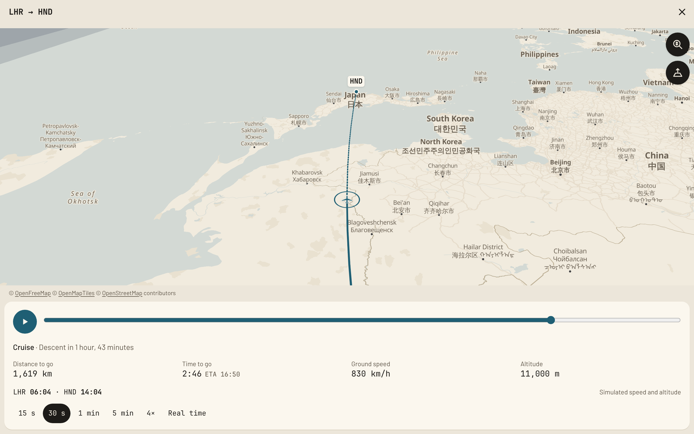

# airchive

Every flight has a story.

airchive turns your boarding passes into a paper keepsake of each flight. You add a
`.pkpass` file, a screenshot of the barcode or the data of the flight. airchive shows a
classic paper boarding pass, a map of the route and a replay of the flight.





The screenshots show sample data.

## Functions

- Sign in with a magic link. Each person holds a private archive.
- Import a `.pkpass` file, or an image with the barcode of the boarding pass. For a PDF
  file, use a screenshot of the barcode. You can also write the data in a form.
- The file stays in the browser. The server receives only the fields that you examined.
- Each flight shows a paper boarding pass with the logo of the airline.
- A map shows the great circle of the route.
- "Relive your flight" moves an aircraft along the route and shows the phase of the
  flight.
- The interface is in English and in Italian.

The public page of a shared journey is the next slice.
[`docs/architecture.md`](docs/architecture.md) gives the decisions and the plan.

## Development

You need Node 22.12 or later.

```bash
npm install
cp .dev.vars.example .dev.vars # then give BETTER_AUTH_SECRET and BETTER_AUTH_URL
npm run db:migrate:local
npm run dev
```

`npm run dev` starts Vite and the Worker on <http://localhost:5173>. The Worker runs in
`workerd`, the runtime of Cloudflare, with a local D1 database. With no
`RESEND_API_KEY`, the magic link is in the log of `npm run dev`.

## License

MIT. Refer to [`LICENSE`](LICENSE).
